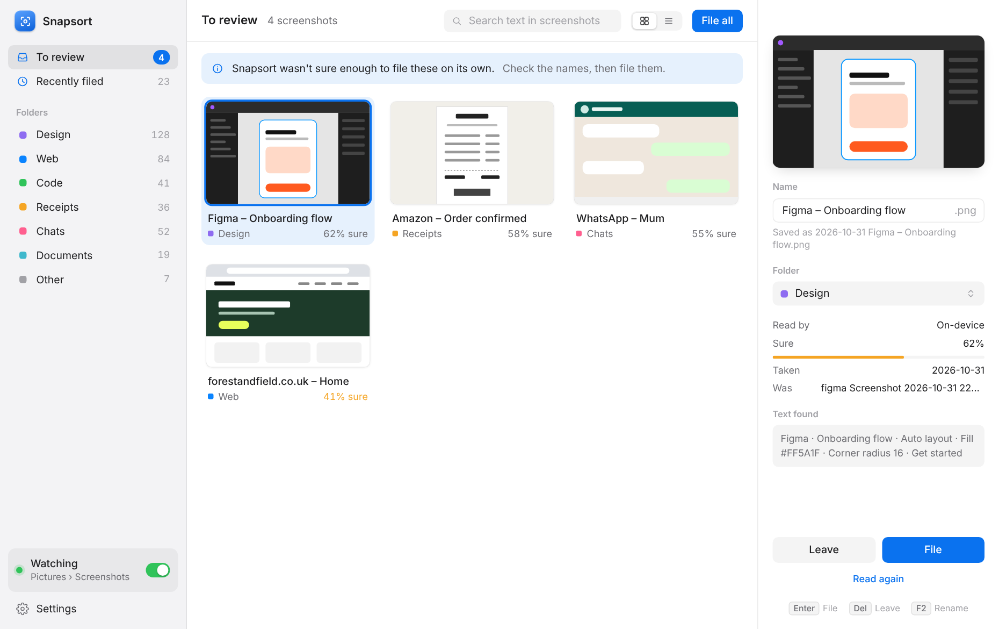
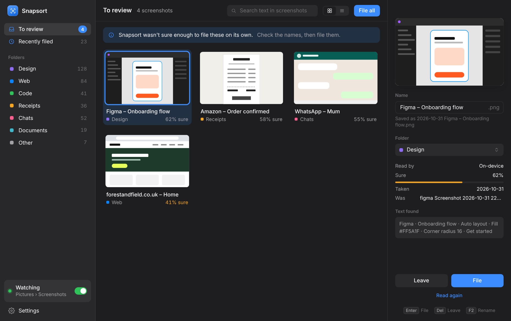
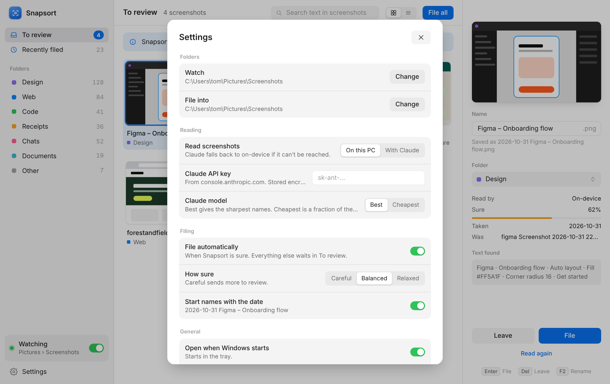
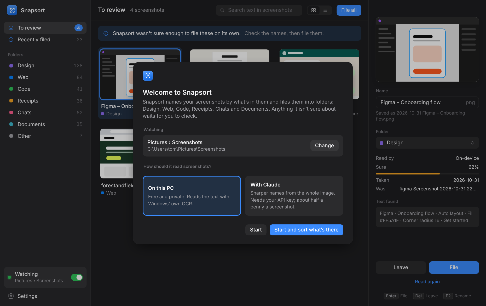

# Snapsort

Snapsort names your screenshots by what's in them and files them into folders, so `Screenshot 2026-10-31 223112.png` becomes `Design/2026-10-31 Figma – Onboarding flow.png`.



## How it works

1. **It watches** `Pictures\Screenshots`, where Windows saves screenshots (Win + Print Screen, and the Snipping Tool).
2. **It reads each new screenshot.** By default this happens on the PC, with the OCR built into Windows, so nothing leaves the machine. If you add a Claude API key, Claude looks at the whole image instead and gives sharper names. If Claude can't be reached, Snapsort falls back to reading on the PC.
3. **It names and files it.** If it's sure, the screenshot goes straight into Design, Web, Code, Receipts, Chats, Documents or Other, and a small card offers **Undo**. If it isn't sure, the screenshot waits in **To review**, where you can fix the name or folder and file it with Enter.

Nothing is deleted. Every move is logged and can be put back from **Recently filed**.

## Features

- Review list with an inspector: preview, editable name, folder, how sure it is, and the text it found
- Search screenshots by the words in them
- Grid and list views, light and dark, and keyboard shortcuts (Enter to file, Del to leave, F2 to rename, Space to preview, arrow keys to move)
- **Sort existing** reads screenshots already in the folder and puts them all in the review list first, so nothing old moves without a look
- Sureness setting: Careful, Balanced or Relaxed
- Tray icon with the review count; runs quietly at login
- Updates itself from GitHub Releases

## Design

The design takes its cues from the best-made Mac and Windows apps: a Finder and Photos-style sidebar and inspector, CleanShot X's floating "just captured" card, and the keyboard-first feel of Raycast and Things. It uses one accent colour, Inter for the type, and Mica on Windows 11.

| Dark | Settings | First run |
|---|---|---|
|  |  |  |

## Development

```bash
npm install
npm start      # run the app
npm test       # run the tests
npm run dist   # build the Windows installer and portable exe
```

Releases: bump `version` in `package.json`, then push a matching tag, e.g. `git tag v0.1.0 && git push origin v0.1.0`. GitHub Actions builds the installer and publishes it to Releases, and installed copies update themselves.

## Privacy

- On-device reading uses Windows' own OCR. Nothing is uploaded.
- With Claude switched on, each new screenshot is sent to the Anthropic API to be described. The API key is stored encrypted with Windows' data protection.
- The text found in each screenshot is kept in Snapsort's history (on the PC) so you can search it.
